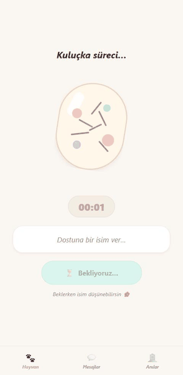

# TamagoVibe

Tamagotchi'den ilham alan, 3D hayvanlı dijital evcil hayvan oyunu. Expo (React Native) ile yazıldı, hedef platform **Android**. İlk sürüm tek oyunculu ve tamamen cihazda çalışır: internet ya da sunucu gerekmez.

## Demo

<p align="center">
  
</p>

*Web sürümünden telefon boyutunda alınmış kayıt: yumurta kuluçkası, çatlama, doğum belgesi (efsanevi Kurt), cihaz arayüzü, oyun, besleme menüsü, rozet bildirimi ve uyku.*

## Özellikler

- **Yumurta ve doğum belgesi:** Hesap açınca yumurta kuluçkaya yatar, sallanır, çatlaklar belirir. Süre dolunca isim verip yumurtayı çatlatırsın. Çıkan hayvanın türü, **nadirliği** (Yaygın / Nadir / Efsanevi), doğum zamanı ve belge numarası bir doğum belgesinde gösterilir.
- **4 hayvan türü (3D, animasyonlu):** Tilki ve Shiba (yaygın), Husky (nadir), Kurt (efsanevi). Ruh haline göre animasyon oynar, bakım eylemlerine tepki verir (yeme, oyun, dokunma, ilaç).
- **Tamagotchi cihaz arayüzü:** Yumurta biçimli kabuk, LCD ekran, kalp göstergeleri ve fiziksel butonlar (Besle, Oyna, Uyut, İlaç).
- **Gerçek zamanlı oyun:** Açlık, mutluluk ve enerji saatler içinde düşer (yaklaşık 8 saatte aç). Uygulama kapalıyken geçen süre açılışta hesaplanır. Kapalıyken pet ölmez, sağlık en az 10'a iner.
- **Bakım:** 6 yemek, oyun, uyku, ilaç, dokunma. XP, seviye atlama, rozetler.
- **Ölüm ve anılar:** Pet ölürse Anılar (mezarlık) sekmesine kaydedilir, yeni hayat başlatılır.
- **Başarımlar:** Rozet kazanınca üstten bildirim çıkar, liste ana ekranda görünür.
- **Demo partner Elif:** Mesajlaşma ve hızlı mesajlar. Gerçek partner eşleşmesi sonraki sürümde.
- **Bildirimler:** Açlık ve kritik sağlık için yerel hatırlatıcılar (cihazda).
- **Hata günlüğü:** Sosyal Panel içinde, son 100 hata saklanır.

## Çalıştırma

```bash
npm install
npm start          # Expo; telefonda Expo Go, web için "w"
npm test           # birim testleri (jest)
```

`.npmrc` içinde `legacy-peer-deps` açıktır, `npm install` bu yüzden ERESOLVE hatası vermez.

## Oyun hızını ayarlama

Tüm oranlar [`src/constants/gameConfig.js`](src/constants/gameConfig.js) içinde:

| Ayar | Anlamı |
|------|--------|
| `DECAY_PER_HOUR` | Saatlik açlık / mutluluk / enerji düşüşü |
| `GAME_SPEED` | Test için hız çarpanı (60 = 1 dakikada 1 saat) |
| `HATCH_TIME_MINUTES` | Yumurta süresi (geliştirmede 1 dk, yayında 10 dk) |
| `PET_TYPES` | Tür, nadirlik ve çıkma şansı (`weight`) |

## Proje yapısı

```
App.js                      # Navigasyon, oturum
src/
├── components/
│   ├── DeviceFrame.jsx     # Tamagotchi kabuğu, LCD, butonlar
│   ├── EggHatch.jsx        # Yumurta, çatlama animasyonu, doğum belgesi
│   ├── PetAvatar.jsx       # 3D sahne, döndürme, dokunma
│   ├── PetModel3D.jsx      # Three.js modeli, kamera, animasyon klipleri
│   └── AuthForm.jsx        # Giriş / kayıt ortak arayüzü
├── constants/              # theme.js (tek tasarım sistemi), gameConfig.js, avatarConfig.js
├── hooks/useSocialPet.js   # Oyun döngüsü ve eylemler
├── screens/                # Pet, Sohbet, Anılar, Sosyal, Giriş, Kayıt
├── services/               # authService, localStore (AsyncStorage), partnerService
└── utils/                  # decay.js (saf oyun hesabı), logger.js, dialog.js
assets/animals/             # 3D modeller (Quaternius, CC0)
__tests__/                  # jest testleri
docs/                       # durum, hata günlüğü, test raporu, değişiklik kaydı
```

## Dokümanlar

- [docs/PROJE_DURUMU.md](docs/PROJE_DURUMU.md): yapılanlar, kalanlar, yayın yol haritası
- [docs/CHANGELOG.md](docs/CHANGELOG.md): tarihli değişiklik kaydı
- [docs/ERROR_LOG.md](docs/ERROR_LOG.md): bulunan hatalar, kök neden, çözüm
- [docs/TEST_RAPORU.md](docs/TEST_RAPORU.md): son test sonuçları
- [docs/YAYIN_ADIMLARI.md](docs/YAYIN_ADIMLARI.md): Android yayını için senin yapacakların (EAS, Play Console)
- [docs/GIZLILIK_POLITIKASI.md](docs/GIZLILIK_POLITIKASI.md) ve [docs/MAGAZA_METNI.md](docs/MAGAZA_METNI.md): mağaza taslakları
- [DEPLOY_CHECKLIST.md](DEPLOY_CHECKLIST.md): mağaza yayın listesi

## Önemli notlar

- Hesaplar ve oyun verisi yalnızca cihazdadır. Şifreler tuzlu SHA-256 özeti olarak saklanır (düz metin değil); eski kayıtlar ilk girişte otomatik yükseltilir. Gerçek güvenlik için ileride sunucu tabanlı hesap gerekir.
- İki cihaz arası senkron yoktur. Gerçek partner özelliği ayrı bir backend ile eklenecek.
- 3D/WebGL ve bildirimler Android cihazda ayrıca doğrulanmalıdır (web testi bunları kapsamaz).

## Krediler ve lisans

3D hayvan modelleri: [Quaternius](https://quaternius.com/) "Ultimate Animated Animal Pack", **CC0 1.0** (kamu malı). Lisans metni `assets/animals/LICENSE-Quaternius-CC0.txt` dosyasındadır.
